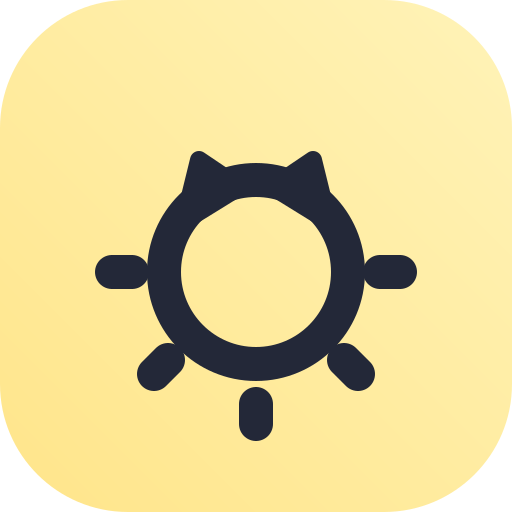
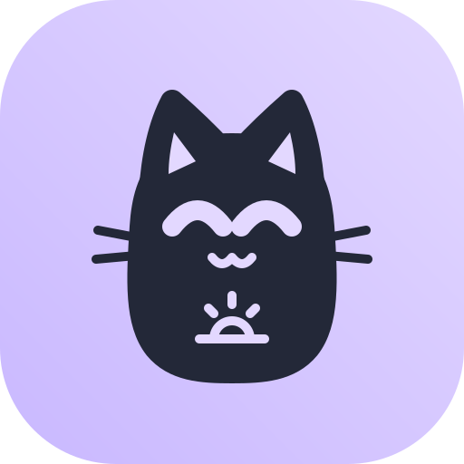
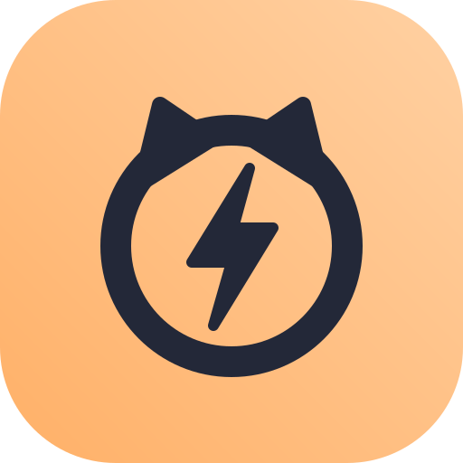

  <picture>
    <source media="(prefers-color-scheme: dark)" srcset="niko-lockup-dark.png">
    
  </picture>

<b>Simple, free Android apps that anyone can use.</b>

Niko builds small apps for the people mainstream apps leave out: people who can't read, older people and disabled people. Each app does one job, such as telling the time out loud or calling family with one tap. No ads, no tracking, no paywalls. They work offline and are accessible from the start.

## Principles

- **One job per app.** Small enough to keep working for years.
- **Free forever.** No ads, no tracking, no paid features. The code will be open source under GPLv3 once the apps are released.
- **Offline.** No internet permission unless an app truly needs it.
- **Accessible by default.** Works with TalkBack, large text and buttons, high contrast.
- **Usable without reading.** Speaks in the phone's own voice and language, with optional recordings from family.
- **Nothing moves.** Fixed layouts, because people remember where things are.
- **Set up by a helper.** A relative can set things up behind a PIN so nothing breaks by accident.
- **Keeps working.** Built to survive battery savers, reboots and Android updates.

## Apps

| | App | What it does | Status |
| --- | --- | --- | --- |
|  | Niko Clock | Speaks the time on shake, a big button or every hour | In progress |
|  | Niko Dialer | Tap a family member's photo to call them | Planned |
|  | Niko Reminders | Reminders in a family member's recorded voice, with a photo | Planned |
|  | Niko Light | A rising tone that tells blind users if a light is on | Planned |
|  | Niko Status | One button says battery, signal and airplane mode | Planned |
|  | Niko Day Clock | "Tuesday morning" in big words and pictures | Planned |
|  | Niko Flash | Flashes the light on calls and messages for older phones | Planned |

Apps will be released on GitHub first.

## How to help

- **Test.** Try an app with someone who would actually use it and tell us what was hard.
- **Translate.** Every app should speak and read in as many languages as possible.
- **Code.** The apps are in private development for now. Code contributions open when the source is published.
- **Spread the word.** Tell disability organisations, carers and families who might benefit.

See [CONTRIBUTING.md](https://github.com/NikoApps/.github/blob/main/CONTRIBUTING.md) to get started.

## Contact

hello@gopalkhadka.com.np
